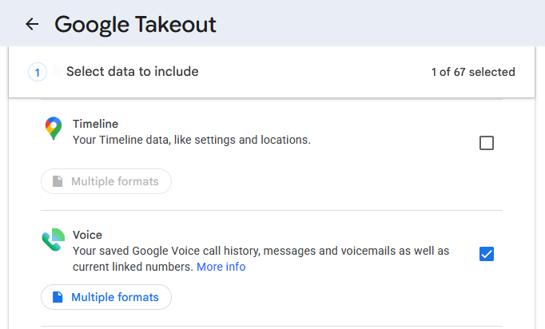
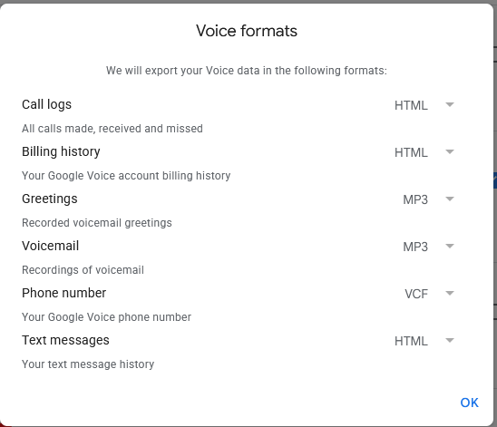

# Alternative: exporting via Google Takeout

Google offers its own way to get Google Voice data out: [Google Takeout](https://takeout.google.com).
It works, and it's official — but it's a poor fit for "save this one conversation,"
which is what this repo's exporter is for. This page documents the tradeoffs.

## How it works

1. Go to https://takeout.google.com.
2. Select **Voice** as the data to export (nothing else needs to be checked).

   

3. Optionally, click **Multiple formats** to preview the export formats — these are
   fixed and can't be changed.

   

4. Click **Next** and choose how to receive the export (a downloadable archive, or
   delivery to a cloud storage provider).

## Why it's more complicated than it looks

- **All-or-nothing.** There's no way to export a single conversation, a date range, or
  just text messages — it's every call, text, voicemail, and missed call across every
  contact, every time.
- **Unpredictable turnaround.** Google generates the archive asynchronously and emails
  you when it's ready; there's no time estimate.
- **HTML only, and not one file per conversation.** Messages come as HTML, which is
  fine for viewing (open it, or print/save as PDF), but converting it to Markdown takes
  extra work — see below.
- **Attachments need matching up.** Images ship alongside the HTML as separate files,
  but the HTML doesn't reference them cleanly (also covered below).

## What the export actually contains

Based on inspecting a real export (which can be gigabytes). Names and phone numbers
below are placeholders standing in for the real contacts that appeared in it.

- Everything lands in a single `Takeout/Voice/Calls/` folder (plus a separate `Spam/`
  folder for spam-labeled numbers) — no per-type or per-contact folders. Content is
  told apart only by filename substrings: `" - Text - "`, `" - Voicemail - "`,
  `" - Missed - "`, `" - Received - "`, `" - Placed - "`, `"Group Conversation - "`.
- **One file per messaging session, not one file per conversation.** A contact you
  text regularly (e.g. "Jane Doe") produces dozens or hundreds of separate files —
  `Jane Doe - Text - 2026-08-02T17_11_35Z.html`, `Jane Doe - Text - 2026-08-03T01_14_42Z.html`,
  and so on — each holding only the messages from that one session. Reconstructing the
  full conversation with "Jane" means finding every file for that contact across the
  entire export and merging them in chronological order. That reassembly work is
  comparable in effort to this repo's DOM-scraping approach, just without the
  live-page fragility.
- **The HTML structure itself is simple and stable** (a `
` of
  `
` blocks) — a real advantage over scraping a live Angular app:
  - Timestamp: `<abbr class="dt" title="2026-08-02T18:14:42.487-07:00">...</abbr>` —
    full ISO 8601 with offset, more precise than anything the live Google Voice DOM
    exposes.
  - Sender: `<cite class="sender vcard"><a class="tel" href="tel:+15555550123">Jane Doe</a></cite>`
    for the other party, vs. `<abbr class="fn" title="">Me</abbr>` (empty title) for
    your own messages — direction is unambiguous, no heuristics needed.
  - Message body: plain `<q>...</q>`.
  - Image attachment: ``
    — the `src` has **no file extension**, even though the actual file in the export is
    named `...-3-1.jpg`. A converter has to resolve the real file by matching the
    basename prefix, not by trusting `src` literally.
  - Some senders are just short codes (e.g. `22395`, `52181` — OTP/marketing texts)
    with no resolved contact name, same as they'd show in the live Google Voice UI.

## Bottom line

Takeout is more reliable — it's an official export, not DOM-scraping — but much more
complicated if all you need is to export a single conversation. It hands you every
call, text, and voicemail across every contact, split into per-session files you'd
still have to group by contact, sort by timestamp, and stitch back together yourself.
That's why this repo takes the DOM-scraping route instead: point it at one open
conversation and get one file back (or multiple, split by year, if you configure it
that way).
