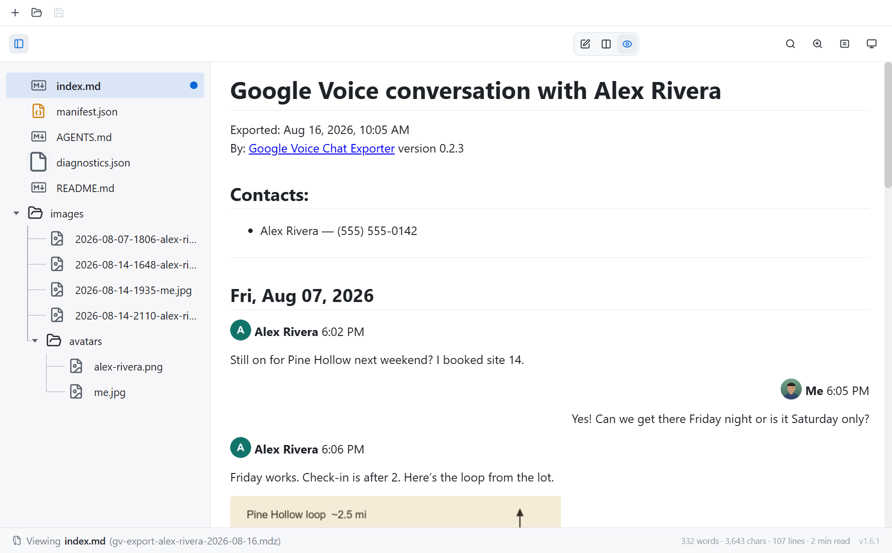
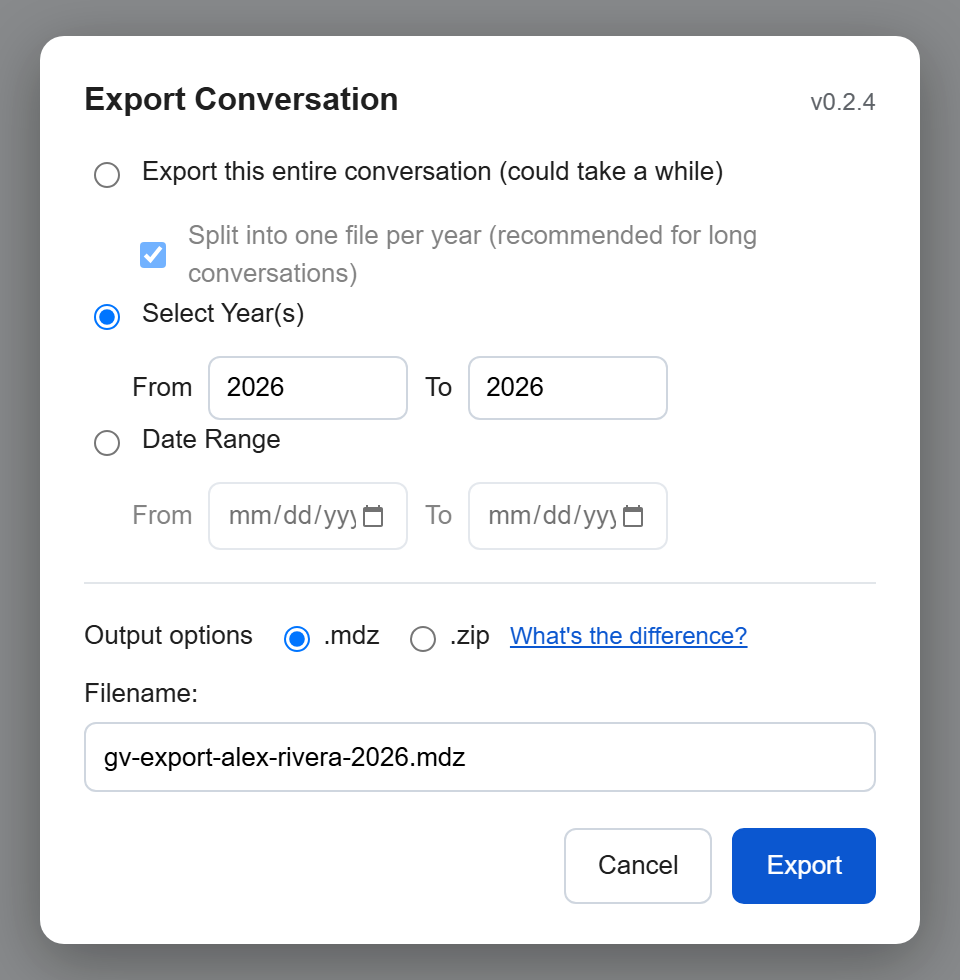
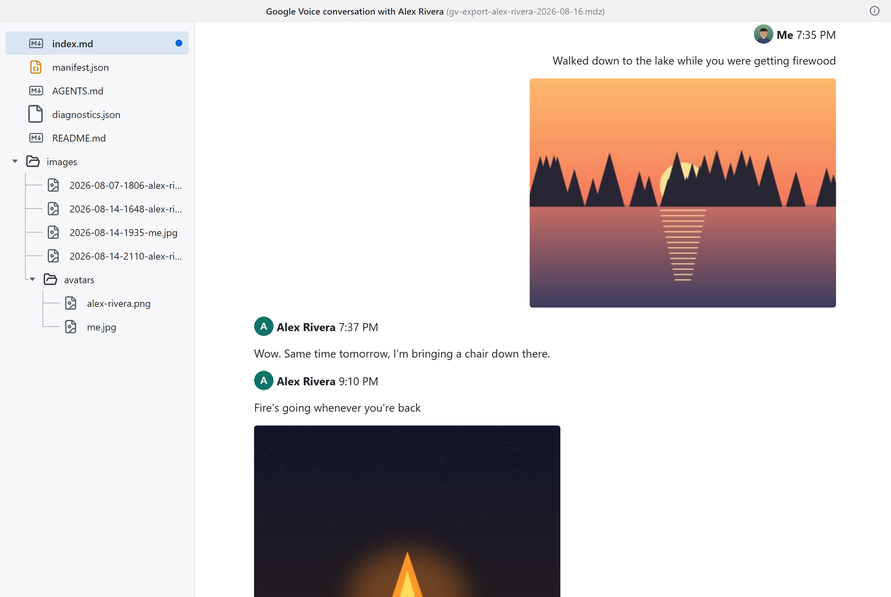
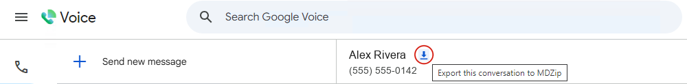

<!--
  Greasy Fork listing description. Greasy Fork syncs this file (Markdown)
  into the listing's "Additional info":
  https://greasyfork.org/en/scripts/603539-google-voice-chat-exporter
  Keep it in step with https://mdzip.org/google-voice.
-->

Save a Google Voice conversation as one file: every message, who sent it, when, and the photos.

Google Voice has no way to save a conversation. You can take screenshots one screen at a time, or ask Google Takeout for your whole account, which gives you every call, text and voicemail with every contact, split into hundreds of files. This script adds an **export icon** to the conversation you have open and saves just that conversation.

### What it does

- Exports the whole conversation, chosen years, or a date range. Long conversations are split into one file per year unless you turn that off.
- Keeps the photos, contact pictures, and who said what. Your own messages sit on the right, like in Google Voice.
- Runs in your browser. Your messages aren't sent anywhere: the script reads the conversation from the page, downloads its photos from Google, and saves the file on your computer.

### What you get

An MDZip (`.mdz`) file. It's a ZIP file with a different extension, holding the conversation as Markdown text plus its photos:

- **In your browser:** drop it on the [MDZip editor](https://mdzip.org/editor.html?from=google-voice). Files open on your computer; nothing is uploaded.
- **In an app:** [MDZip Studio](https://mdzip.org/studio.html) on Windows and Linux (installed for all users on Windows, it also adds a File Explorer preview), or the VS Code and Obsidian plugins.
- **Without any MDZip tool:** rename it to `.zip` and extract it. Open `index.md` in any Markdown editor, or look through the `images` folder.

Because the conversation is plain text, you can search it, print it to PDF, paste it into Word, or hand it to an AI assistant, and it stays readable whatever happens to Google Voice.

### How to use it

1. Install this script with a userscript manager such as [Violentmonkey](https://violentmonkey.github.io/) or [Tampermonkey](https://www.tampermonkey.net/).
2. Open (or reload) a conversation at [voice.google.com](https://voice.google.com).
3. Click the **export icon** in the conversation's header, choose what to export, and choose **Export**.
4. Leave the tab open. The script scrolls back through the conversation to load its history, which can take a while for a long one, then downloads the file.

### Good to know

- **It exports the conversation you have open,** one at a time. For every conversation at once, use Google Takeout.
- **It reads the page as you see it.** Google Voice has no export feature to build on, so if Google changes the page, the script may miss something until it's updated. When something can't be read, the file says so.
- **The file holds the conversation as it is,** names and phone numbers included. Check it before you share it.
- **In Chrome and Edge,** your userscript manager may need **Allow User Scripts** or **Developer mode** turned on before scripts run.
- Not made by or affiliated with Google. Google Voice is a trademark of Google LLC.

More, including what's inside the file: [mdzip.org/google-voice](https://mdzip.org/google-voice). Source and issues: [GitHub](https://github.com/mdzip-project/mdzip-google-voice-exporter).
